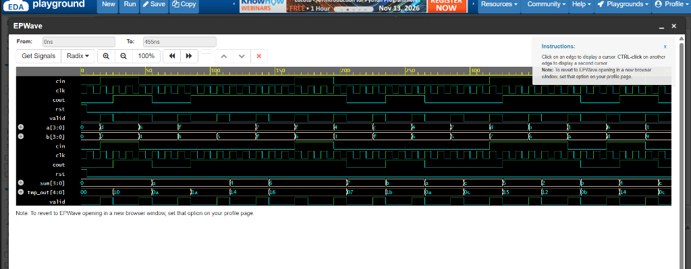

# SystemVerilog Design & Verification

A collection of SystemVerilog digital design modules, testbenches, simulation waveforms, and study notes demonstrating fundamental hardware description and layered verification concepts.

---

## 📁 Repository Structure

```text
System-Verilog/
├── FullAdder_4bit_SV/
│   ├── design.sv                                           # 4-bit registered full adder DUT
│   ├── interface.sv                                        # Interface definition (clk, rst, valid, a[3:0], b[3:0], cin, sum[3:0], cout)
│   ├── transaction.sv                                      # Transaction class with dual decimal/hex display
│   ├── generator.sv                                        # Generator producing randomized 4-bit transaction packets
│   ├── driver.sv                                           # Driver translating transactions to interface pins
│   ├── monitor.sv                                          # Monitor sampling 4-bit adder inputs and registered outputs
│   ├── scoreboard.sv                                       # Golden reference model verifying sum and carry
│   ├── environment.sv                                      # Phased testbench environment orchestrator
│   ├── test.sv                                             # Test program configuring repeat_count & initiating run
│   ├── testbench.sv                                        # Top-level testbench module instantiating interface, DUT & test
│   └── waveform_4bit_fa.png                                # EPWave simulation waveform
├── FullAdder_SV/
│   ├── full_adder.sv.txt                                   # 1-bit registered full adder DUT
│   ├── interface.sv.txt                                    # Interface definition (clk, rst, valid, a, b, cin, sum, cout)
│   ├── transaction.sv.txt                                  # Transaction class with rand stimulus (a, b, cin) and outputs
│   ├── generator.sv.txt                                    # Generator producing randomized 1-bit transactions
│   ├── driver.sv.txt                                       # Driver translating transactions to interface pins
│   ├── monitor.sv.txt                                      # Monitor passively sampling full adder signals
│   ├── scoreboard.sv.txt                                   # Scoreboard evaluating {cout, sum} == a + b + cin
│   ├── environment.sv.txt                                  # Environment orchestrating components & lifecycle
│   ├── test.sv.txt                                         # Test program configuring repeat_count & initiating run
│   └── testbench.sv.txt                                    # Top-level module with clock, reset, interface & DUT
├── ADDER_SV/
│   ├── adder.sv.txt                                        # Registered 4-bit adder DUT with valid handshake & async reset
│   ├── interface.sv.txt                                    # Interface definition connecting testbench and DUT
│   ├── transaction.sv.txt                                  # Transaction class with randomized stimulus (a, b) and response (c)
│   ├── generator.sv.txt                                    # Generator class producing randomized transactions
│   ├── driver.sv.txt                                       # Driver class converting transactions to interface pin wiggles
│   ├── monitor.sv.txt                                      # Monitor class sampling pin activity and packaging transactions
│   ├── scoreboard.sv.txt                                   # Scoreboard class verifying DUT outputs against reference model
│   ├── environment.sv.txt                                  # Environment class orchestrating TB components and phases
│   ├── test.sv.txt                                         # Test program configuring test parameters
│   ├── testbench.sv.txt                                    # Top-level testbench module instantiating DUT, interface & test
│   ├── Screenshot 2026-11-14 153845.png                   # Initial adder waveform
│   ├── Screenshot 2026-11-15 101912.png                   # Layered testbench simulation waveform
│   └── WhatsApp Image 2026-11-15 at 10.20.29 AM.jpeg       # Simulation output & test execution log
├── up_down_counter/
│   ├── up_down.sv.txt                                      # 4-bit synchronous up/down counter design & testbench
│   └── Screenshot 2026-11-14 113728.png                   # Simulation waveform
├── blocking vs non_blocking/
│   ├── blocking_vs non_blocking.sv.txt                    # Comparison between blocking (=) & non-blocking (<=)
│   └── Screenshot 2026-11-14 111457.png                   # Comparative simulation waveform
├── Verilog_SystemVerilog_Study_Notes.docx                  # Comprehensive study & interview notes
├── Sysyem_Verilog.png                                      # SystemVerilog architecture & reference diagram
└── README.md
```

---

## 📌 Projects & Modules

### 1. 4-Bit Full Adder Layered Verification Environment (`FullAdder_4bit_SV/`)

A 4-bit synchronous binary vector full adder design verified using a complete object-oriented, constrained-random layered testbench.

#### A. Design Under Test (DUT - `design.sv`)
- **Arithmetic Function:** Computes 4-bit addition with carry-in: $\{ \text{cout}, \text{sum}[3:0] \} = a[3:0] + b[3:0] + \text{cin}$.
- **Bit-Width Range:** Operands $a, b \in [0, 15]$, $\text{cin} \in [0, 1]$; maximum result is $15 + 15 + 1 = 31$ (`5'b11111`), stored in `tmp_out[4:0]`.
- **Clock Edge & Reset:** Uses `always_ff @(posedge clk or posedge rst)` with asynchronous active-high reset.
- **Valid Enable Handshake:** Computes and updates output registers only when `valid = 1`.

##### Port List

| Port Name | Direction | Width | Description |
| :--- | :---: | :---: | :--- |
| `clk` | Input | 1 bit | System clock signal (period = 10ns) |
| `rst` | Input | 1 bit | Asynchronous active-high reset |
| `valid` | Input | 1 bit | Input data valid handshake |
| `a` | Input | 4 bits | 4-bit operand input A (`[3:0]`) |
| `b` | Input | 4 bits | 4-bit operand input B (`[3:0]`) |
| `cin` | Input | 1 bit | Carry-in signal |
| `sum` | Output | 4 bits | Registered 4-bit sum output (`[3:0]`) |
| `cout` | Output | 1 bit | Registered carry-out bit |

#### B. Verification Components Breakdown

| Component | File | Description |
| :--- | :--- | :--- |
| **Transaction** | `transaction.sv` | Generates randomized 4-bit inputs (`rand bit [3:0] a, b`, `rand bit cin`) and response containers with dual decimal/binary formatting. |
| **Interface** | `interface.sv` | Bundles `clk`, `rst`, `valid`, `a[3:0]`, `b[3:0]`, `cin`, `sum[3:0]`, `cout` into `intf`. |
| **Generator** | `generator.sv` | Generates 15 randomized transaction packets, checks `.randomize()`, pushes to `mailbox gen2driv`, and triggers `->ended`. |
| **Driver** | `driver.sv` | Executes reset sequence, pulls transactions from `gen2driv`, and drives synchronous pin wiggles on clock rising edges. |
| **Monitor** | `monitor.sv` | Passively samples `vif` pins on clock edges when `valid` is asserted and captures registered outputs on the next clock edge into `mailbox mon2scb`. |
| **Scoreboard** | `scoreboard.sv` | Reference model computing $\{ \text{exp\_cout}, \text{exp\_sum} \} = a + b + \text{cin}$ and checking equality with actual outputs. |
| **Environment** | `environment.sv` | Orchestrates four-phase lifecycle: `pre_test` $\rightarrow$ `test` $\rightarrow$ `post_test` $\rightarrow$ `run`. |
| **Test Program** | `test.sv` | Configures `repeat_count = 15` and initiates simulation execution. |
| **Top Testbench** | `testbench.sv` | Module `top` generating master clock (`always #5 clk = ~clk;`), reset pulse, and instantiating DUT, interface, and test. |

#### C. Simulation Waveform Analysis



##### Waveform Trace Highlights:
1. **At ~50ns**:
   - Inputs: $a = \text{4'hd}\ (13)$, $b = \text{4'h2}\ (2)$, $\text{cin} = 1$
   - Calculation: $13 + 2 + 1 = 16 = \text{5'h10}$
   - Registered output `tmp_out[4:0] = 5'h10` $\rightarrow$ `cout = 1`, `sum = 4'h0`.
2. **At ~80ns**:
   - Inputs: $a = \text{4'h6}\ (6)$, $b = \text{4'h4}\ (4)$, $\text{cin} = 0$
   - Calculation: $6 + 4 + 0 = 10 = \text{5'h0a}$
   - Registered output `tmp_out[4:0] = 5'h0a` $\rightarrow$ `cout = 0`, `sum = 4'ha` (10).
3. **At ~110ns**:
   - Inputs: $a = \text{4'hf}\ (15)$, $b = \text{4'hb}\ (11)$, $\text{cin} = 0$
   - Calculation: $15 + 11 + 0 = 26 = \text{5'h1a}$
   - Registered output `tmp_out[4:0] = 5'h1a` $\rightarrow$ `cout = 1`, `sum = 4'ha` (10).
4. **At ~170ns**:
   - Inputs: $a = \text{4'hf}\ (15)$, $b = \text{4'hf}\ (15)$, $\text{cin} = 0$
   - Calculation: $15 + 15 + 0 = 30 = \text{5'h1e}$
   - Registered output `tmp_out[4:0] = 5'h1e` $\rightarrow$ `cout = 1`, `sum = 4'he` (14).

---

### 2. Full Adder Layered Verification Environment (`FullAdder_SV/`)

A 1-bit synchronous Full Adder design verified using an object-oriented, constrained-random layered testbench architecture.

#### A. Design Under Test (DUT - `full_adder.sv.txt`)
- **Truth Table / Function:** Computes sum and carry-out: $\{ \text{cout}, \text{sum} \} = a + b + \text{cin}$.
- **Clock Edge & Reset:** Uses `always_ff @(posedge clk or posedge rst)` with active-high asynchronous reset.
- **Valid Enable:** Performs addition and updates output registers on `valid = 1`.

##### Port List

| Port Name | Direction | Width | Description |
| :--- | :---: | :---: | :--- |
| `clk` | Input | 1 bit | System clock signal |
| `rst` | Input | 1 bit | Asynchronous active-high reset |
| `valid` | Input | 1 bit | Input data valid handshake |
| `a` | Input | 1 bit | Operand A input |
| `b` | Input | 1 bit | Operand B input |
| `cin` | Input | 1 bit | Carry-in input |
| `sum` | Output | 1 bit | Registered sum output ($a \oplus b \oplus \text{cin}$) |
| `cout` | Output | 1 bit | Registered carry-out output ($(a \cdot b) + (b \cdot \text{cin}) + (a \cdot \text{cin})$) |

#### B. Verification Components Breakdown

| Component | File | Description |
| :--- | :--- | :--- |
| **Transaction** | `transaction.sv.txt` | Encapsulates 1-bit stimuli (`rand bit a, b, cin`) and outputs (`bit sum, cout`) with custom banner formatting. |
| **Interface** | `interface.sv.txt` | Groups physical signals (`clk`, `rst`, `valid`, `a`, `b`, `cin`, `sum`, `cout`) in `intf`. |
| **Generator** | `generator.sv.txt` | Generates randomized transactions over `repeat_count` runs, checks `.randomize()`, pushes to `gen2driv`, and triggers `->ended`. |
| **Driver** | `driver.sv.txt` | Executes reset task, pulls transactions from `gen2driv`, and drives interface pins synchronously with `valid` handshake. |
| **Monitor** | `monitor.sv.txt` | Passively samples `vif` pins on clock edges when `valid` is high, capturing inputs and outputs into transactions pushed to `mon2scb`. |
| **Scoreboard** | `scoreboard.sv.txt` | Self-checking golden reference model verifying $\{ \text{trans.cout}, \text{trans.sum} \} == (trans.a + trans.b + trans.cin)$. |
| **Environment** | `environment.sv.txt` | Manages component lifecycles across phases (`pre_test` $\rightarrow$ `test` $\rightarrow$ `post_test` $\rightarrow$ `run`). |
| **Test Program** | `test.sv.txt` | Configures test parameters (`repeat_count = 10`) and initiates execution via `env.run()`. |
| **Top Testbench** | `testbench.sv.txt` | Module `top` generating clock (`always #5 clk = ~clk;`) and reset, instantiating `intf`, `full_adder dut`, and `test t1`. |

---

### 3. Synchronous 4-Bit Adder & Layered Verification Environment (`ADDER_SV/`)

A registered 4-bit binary adder design accompanied by a complete, modular, object-oriented SystemVerilog layered testbench environment following industry-standard verification methodology.

#### A. Design Under Test (DUT - `adder.sv.txt`)
- **Bit-width:** Adds two 4-bit inputs (`a[3:0]`, `b[3:0]`) producing a 5-bit registered sum output (`c[4:0]`) to accommodate carry-out.
- **Clock Edge & Reset:** Uses `always_ff @(posedge clk or posedge rst)` for sequential registered logic with asynchronous active-high reset.
- **Valid Enable Handshake (`valid`):** Computes and registers `a + b` into `tmp_c` only when `valid = 1`.
- **Registered Output:** Continuous assignment `assign c = tmp_c;` safely drives the registered lower 5 bits.

##### Port List

| Port Name | Direction | Width | Description |
| :--- | :---: | :---: | :--- |
| `clk` | Input | 1 bit | System clock signal |
| `rst` | Input | 1 bit | Asynchronous active-high reset |
| `valid` | Input | 1 bit | Input data valid flag (enables addition) |
| `cin` | Input | 1 bit | Carry-in signal |
| `a` | Input | 4 bits | 4-bit operand input A |
| `b` | Input | 4 bits | 4-bit operand input B |
| `c` | Output | 5 bits | 5-bit registered sum output (`tmp_c[4:0]`) |

#### B. Simulation Waveforms & Verification Output

##### Layered Testbench Simulation Waveform


##### Verification Execution Log & Waveform Details


---

### 4. 4-Bit Up/Down Counter (`up_down_counter/`)

A 4-bit synchronous binary counter capable of counting up or down based on a control input.

#### Features
- **Bit-width:** 4-bit (`[3:0]`), counting from `0` to `15` (`4'h0` to `4'hF`) with rollover.
- **Clock Edge:** Synchronous operation triggered on the rising edge of `clk` (`posedge clk`).
- **Synchronous Reset (`rst`):** When active high (`rst = 1`), resets `count` to `4'b0000`.
- **Direction Control (`up_down`):**
  - `up_down = 1`: Increments `count` by `1` (`count + 1`).
  - `up_down = 0`: Decrements `count` by `1` (`count - 1`).

#### Port List

| Port Name | Direction | Width | Description |
| :--- | :---: | :---: | :--- |
| `clk` | Input | 1 bit | System clock signal |
| `rst` | Input | 1 bit | Synchronous active-high reset |
| `up_down` | Input | 1 bit | Direction selector (`1` = Up, `0` = Down) |
| `count` | Output (reg) | 4 bits | 4-bit counter output register |

#### Simulation Waveform


---

### 5. Blocking vs Non-Blocking Assignment Comparison (`blocking vs non_blocking/`)

Demonstrates and compares the behavior of **Blocking (`=`)** and **Non-Blocking (`<=`)** procedural assignments in sequential logic blocks.

#### Key Concept Comparison

| Feature | Blocking Assignment (`=`) | Non-Blocking Assignment (`<=`) |
| :--- | :--- | :--- |
| **Execution Order** | Evaluated and assigned immediately in sequential order | Right-hand side (RHS) evaluated first; scheduled to update in the NBA region |
| **Synthesized Logic** | Typically used for combinational logic (`always_comb` / `always @*`) | Recommended standard for sequential logic (`always_ff` / `always @(posedge clk)`) |
| **Race Conditions** | Can cause simulation race conditions and mismatch between RTL and gate-level netlists | Eliminates race conditions across communicating synchronous flip-flops |

#### Simulation Waveform


---

## 📚 Study Notes & Reference Materials

- **`Verilog_SystemVerilog_Study_Notes.docx`**: In-depth reference notes covering data types, procedural blocks (`always_comb`, `always_ff`, `always_latch`), OOP in SystemVerilog, constraints, randomization, and verification concepts.
- **`Sysyem_Verilog.png`**: High-level visual cheat sheet / diagram outlining key language constructs and verification architecture.

---

## 🚀 How to Run and Simulate

You can simulate these files using standard EDA tools or online simulators like [EDA Playground](https://www.edaplayground.com/):

### Using Icarus Verilog (`iverilog`) & GTKWave

```bash
# For 4-Bit Full Adder Layered Testbench
iverilog -g2012 -o fa4_sim FullAdder_4bit_SV/design.sv FullAdder_4bit_SV/testbench.sv
vvp fa4_sim

# For 1-Bit Full Adder Layered Testbench
iverilog -g2012 -o fa_tb_sim FullAdder_SV/full_adder.sv.txt FullAdder_SV/testbench.sv.txt
vvp fa_tb_sim

# For 4-Bit Adder Testbench
iverilog -g2012 -o adder_tb_sim ADDER_SV/adder.sv.txt ADDER_SV/testbench.sv.txt
vvp adder_tb_sim

# For 4-Bit Up/Down Counter
iverilog -g2012 -o counter_sim up_down_counter/up_down.sv.txt
vvp counter_sim
```

### Using Synopsys VCS / Cadence Xcelium / ModelSim / EDA Playground
1. Paste `design.sv` in the design pane and other testbench files in their respective tabs.
2. Select **Synopsys VCS** (or **Cadence Xcelium** with `run.do`).
3. Check **Open EPWave after run** to view interactive waveforms.
